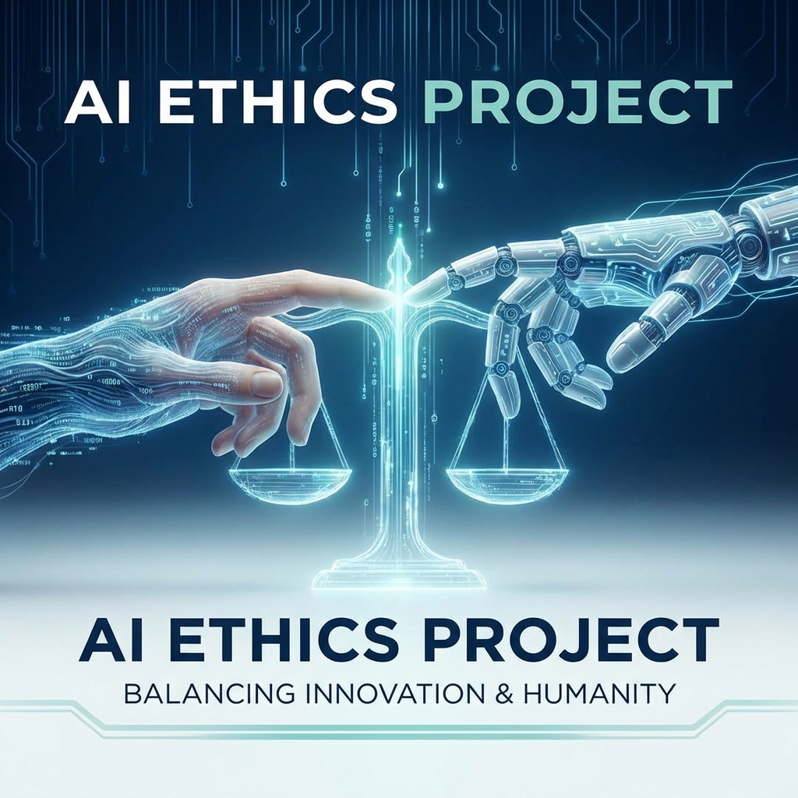

# 🤖 Yapay Zeka Etik ve Denetim Uzmanlığı Rehberi




> **Teknolojinin vicdan mühendisleri** - Yapay zekâ sistemlerinin etik, yasal ve insani değerlere uygun şekilde geliştirilmesini sağlayan uzmanlık alanı.

---

## 📑 İçindekiler

- [Yapay Zeka Etik ve Denetim Uzmanı Kimdir?](#-yapay-zeka-etik-ve-denetim-uzmanı-kimdir)
- [Ne İş Yaparlar?](#-ne-iş-yaparlar)
- [Hangi Alanlarda Çalışabilirler?](#-hangi-alanlarda-çalışabilirler)
- [Gereken Yetkinlikler](#-gereken-yetkinlikler)
- [Nasıl Uzman Olunur?](#-nasıl-uzman-olunur)
- [Gelecek Perspektifi](#-gelecek-perspektifi)
- [Yol Haritası](#-yapay-zeka-etik-ve-denetim-uzmanlığı-yol-haritası)
- [Pratik Örnekler](#-pratik-örnekler)
- [Geleceğin Vicdanı](#-yapay-zeka-etik-uzmanlığı-geleceğin-vicdanı)
- [Kaynaklar](#-kaynaklar)

---

### 🧠 **Yapay Zeka Etik ve Denetim Uzmanı Kimdir?**

Bu uzman, geliştirilen yapay zekâ sistemlerinin:

* **etik kurallara**,
* **yasal düzenlemelere**,
* **insan haklarına**,
* ve **güvenlik standartlarına**
  uygun şekilde tasarlanmasını, eğitilmesini ve kullanılmasını denetleyen kişidir.

Yani kısaca: “AI geliştiricilerin vicdanı ve hukuk danışmanı” gibi düşünebilirsin. ⚖️🤖

---

### 🎯 **Ne İş Yaparlar?**

* **Etik denetim:** Algoritmaların ayrımcılık (bias), adaletsizlik veya manipülasyon yapmadığını test eder.
* **Şeffaflık raporu hazırlar:** Kullanılan modellerin nasıl karar verdiğini belgeleyip açıklanabilir hale getirir.
* **Uyum (compliance) kontrolleri:** GDPR, AB Yapay Zeka Yasası (AI Act), KVKK gibi düzenlemelere uygunluğu inceler.
* **Risk analizi:** Yapay zekâ sisteminin olası sosyal, psikolojik, çevresel etkilerini değerlendirir.
* **Politika danışmanlığı:** Şirketlere etik rehberler ve sorumlu AI stratejileri geliştirir.

---

### 🧩 **Hangi Alanlarda Çalışabilirler?**

* Fintek (otomatik kredi değerlendirme sistemleri)
* Sağlık teknolojileri (teşhis destek sistemleri)
* Kamu yönetimi (otomatik karar verme süreçleri)
* Büyük teknoloji şirketleri (AI governance ekipleri)
* Akademi ve araştırma merkezleri
* Denetim firmaları (örneğin PwC, Deloitte, EY gibi şirketlerde “AI audit” birimleri oluşuyor)

---

### 🧭 **Gereken Yetkinlikler**

| Teknik Taraf                            | Etik ve Hukuk Tarafı                       |
| --------------------------------------- | ------------------------------------------ |
| Veri bilimi temelleri                   | Yapay zeka etiği (bias, adalet, şeffaflık) |
| Algoritmik açıklanabilirlik             | İnsan hakları ve etik felsefe bilgisi      |
| Model değerlendirme ve denetim araçları | KVKK, GDPR, AI Act bilgisi                 |
| Python, R, AI auditing tool’ları        | Kurumsal sorumluluk, risk yönetimi         |

Bu alanın en büyük olayı **“teknoloji ile insani değerleri buluşturmak”** olması.
Yani hem yazılım hem felsefe tarafında güçlü olmak burada çok işine yarar.

---

### 🪜 **Nasıl Uzman Olunur?**

1. **Yapay zekâ / veri bilimi temeli oluştur.**
   (Python, veri analizi, makine öğrenmesi temelleri)
2. **Etik ve hukuk üzerine sertifika veya eğitim al.**

   * OECD AI Principles
   * EU AI Act eğitimleri
   * IEEE “Ethically Aligned Design” kılavuzu
3. **AI Denetim araçlarıyla pratik yap.**
   (örneğin IBM AI Fairness 360, Google What-If Tool)
4. **Kendi etik denetim raporu hazırla** – portföyde fark yaratır.
5. **Uluslararası ağlara katıl:**
   “AI Ethics Lab”, “Partnership on AI”, “The Future Society” gibi topluluklar çok iyi başlangıç noktaları.

---

### 🔮 **Gelecek Perspektifi**

Yapay zekâ yasaları ve denetim zorunlulukları arttıkça bu uzmanlık altın değerinde olacak.
Örneğin:

* Avrupa Birliği **AI Act** kapsamında, her AI sistemi **etik denetimden geçmek zorunda** olacak.
* Şirketler bu iş için **AI Ethics Officer** veya **AI Auditor** pozisyonları açıyor.

Yani bu meslek birkaç yıl içinde, **“siber güvenlik uzmanı kadar stratejik”** hale gelecek. ⚡


## 🧭 **Yapay Zeka Etik ve Denetim Uzmanlığı Yol Haritası**

### 🎓 **1. Temel Zemin: Teknoloji ve Mantık Altyapısı (Level 1)**

> Amaç: Yapay zekanın nasıl çalıştığını anlamak. Denetleyebilmek için önce nasıl üretildiğini bilmelisin.

**Öğrenmen gerekenler:**

* Python (temel + orta seviye)
* Veri bilimi (NumPy, Pandas, Matplotlib)
* Makine öğrenmesi temel algoritmalar (linear regression, decision tree, clustering)
* Yapay zekanın karar mantığı ve model eğitimi

**Kaynak önerileri:**

* “Python for Everybody” (Coursera)
* “Machine Learning with Python” (IBM)
* Google Crash Course on ML
* Kitap: *Artificial Intelligence – A Guide for Thinking Humans (Melanie Mitchell)*

---

### ⚖️ **2. Etik Felsefesi ve Hukuk Bilinci (Level 2)**

> Amaç: “Ne doğru, ne yanlış?” sorusuna teknolojik açıdan yanıt bulmak.

**Konular:**

* Etik felsefesi temelleri (faydacılık, deontoloji, erdem etiği)
* Dijital çağda etik sorunlar (veri gizliliği, önyargı, manipülasyon)
* Yapay zekâ düzenlemeleri (GDPR, KVKK, EU AI Act)
* İnsan hakları – teknoloji ilişkisi

**Kaynaklar:**

* *Ethics of Artificial Intelligence* (Oxford Üniversitesi – ücretsiz online)
* *AI Ethics* (Mark Coeckelbergh kitabı)
* Coursera: *AI For Everyone (Andrew Ng)* — etik kısmı mükemmel özetliyor
* IEEE Etik Kılavuzu: *Ethically Aligned Design*

---

### 🧪 **3. Uygulamalı Etik Denetim Araçları (Level 3)**

> Artık “AI etik ihlali” tespit etmeyi öğreniyorsun.

**Öğrenilecek araçlar:**

* IBM **AI Fairness 360** → bias (önyargı) ölçümü
* Google **What-If Tool** → model kararlarını analiz etme
* Microsoft **Responsible AI Toolbox**
* LIME & SHAP → Model açıklanabilirliği

**Uygulama fikirleri:**

* Bir kredi değerlendirme sistemini etik olarak analiz et
* Görüntü sınıflandırma modelinde cinsiyet veya ten rengi bias’ı tespit et
* Mini bir “AI Etik Denetim Raporu” hazırla (portföyüne koy!)

---

### 🧩 **4. Regülasyon ve Risk Yönetimi (Level 4)**

> Bu aşamada sen artık teknik denetçi gibi düşünüyorsun.

**Odak noktaları:**

* AB AI Act kategorileri (Yüksek riskli sistemler vs.)
* Etik risk yönetimi ve sorumluluk zinciri
* Veri koruma ilkeleri
* Kurumsal denetim raporu formatları

**Kaynak önerileri:**

* EU AI Act resmi metni (okuması sıkıcı ama özetini bilmek şart)
* PwC veya Deloitte’un AI Governance raporları
* LinkedIn Learning: *AI Governance: Managing AI Risk*

---

### 🌍 **5. Global Network ve Sertifikalar (Level 5)**

> Uluslararası alanda görünür olmanın zamanı!

**Alabileceğin sertifikalar:**

* 📜 *AI Ethics and Responsible AI* (University of Helsinki)
* 📜 *Responsible AI Leadership* (MIT Sloan)
* 📜 *AI Governance Professional Certificate* (IEEE)
* 📜 *Data Privacy and Ethics* (IBM / edX)

**Topluluklara katıl:**

* *Partnership on AI*
* *AI Ethics Lab*
* *The Future Society*
* *Women in AI Ethics* (erkekler de katılabiliyor, network harika)

---

### 🚀 **6. Uzmanlaşma ve Kariyer Yolu (Final Level)**

> Artık yapay zekâ projelerinde etik denetçi veya danışman olarak görev alabilirsin.

**Kariyer pozisyonları:**

* AI Ethics & Governance Specialist
* AI Compliance Officer
* Responsible AI Consultant
* AI Risk Auditor

**İş fırsatları genelde:**

* Büyük teknoloji şirketleri (Google, Microsoft, IBM)
* Denetim devleri (PwC, EY, Deloitte, KPMG)
* Kamu kurumları ve etik denetim kurulları
* Startuplar (etik uyumluluk danışmanı olarak)

---

### 💡 Bonus: Gelişmiş Beceriler (Seviye atlatır)

* NLP modellerinde dil önyargısı tespiti
* Büyük dil modellerinin etik prompt eğitimi
* Etik veri seti oluşturma yöntemleri
* AI Explainability ve model izleme sistemleri


## 💻 **Pratik Örnekler**

Bu repoda, AI etik denetimi için pratik kod örnekleri bulunmaktadır. `examples/` klasöründe:

- **`bias_detection_example.py`** - Bias (önyargı) tespiti örneği
- **`model_explainability_example.py`** - Model açıklanabilirliği (SHAP) örneği
- **`ethics_checklist.py`** - Etik denetim checklist script'i
- **`dashboard.py`** - (YENİ) İnteraktif Streamlit Dashboard'u. Bias ve model kararlarını görselleştirmek için.

Detaylı bilgi için [examples/README.md](examples/README.md) dosyasına bakın.

### Hızlı Başlangıç

```bash
# Örnekleri çalıştırmak için
cd examples
pip install -r requirements.txt

# İnteraktif Dashboard'u Başlatmak İçin:
streamlit run dashboard.py

# Diğer scriptler:
python bias_detection_example.py
python model_explainability_example.py
python ethics_checklist.py
```

---

## ⚖️ **Yapay Zeka Etik Uzmanlığı: Geleceğin Vicdanı**

21. yüzyılın ilk yarısı, insanlık tarihinin en hızlı değişen dönemlerinden biri olacak. Yapay zekâ, artık sadece kod satırlarında değil; mahkeme kararlarında, hastane raporlarında, banka kredilerinde, hatta sosyal ilişkilerimizde bile rol oynuyor.
    Ama bir soru, giderek daha fazla yankılanıyor:
    **“Bu sistemler adil mi, şeffaf mı, insanca mı?”**

İşte tam burada **Yapay Zekâ Etik Uzmanları** devreye giriyor — geleceğin görünmez kahramanları.

---

### 🧭 Yeni Çağın Mesleği: Teknolojinin Vicdan Mühendisleri

Yapay zeka geliştiriciler algoritmaları yazarken, etik uzmanları onların **toplumsal etkilerini** okuyor.
Bu uzmanlar, “nasıl yapılır”dan çok, **“nasıl yapılmalı”** sorusuna odaklanıyor.

Onlar, makinelerin veriye değil, **değerlere** dayanarak çalıştığı bir çağın kapısını aralıyor.
Bir AI etik uzmanı için görev tanımı basit ama derin:

> “İnsanı korumak, veriyi değil.”

Bu meslek, gelecekteki her kurumun stratejik merkezinde olacak. Çünkü yapay zekânın etik çerçevesi, sadece bir güvenlik duvarı değil; bir **itibar zırhı**, bir **insanlık sözleşmesi** olacak.

---

### 🔮 Geleceğin Manzarası

* **Her yapay zekâ ürünü**, tıpkı elektrikli araçlarda “emisyon testi” gibi, “etik denetimden” geçmek zorunda kalacak.
* Şirketlerde **Chief AI Ethics Officer** pozisyonları, CFO veya CTO kadar güçlü hale gelecek.
* Üniversitelerde “Etik Kodlama” dersleri zorunlu olacak.
* Etik uzmanları, yalnızca hataları tespit eden değil, **toplumla teknoloji arasında köprü kuran kişiler** olacak.
* Yapay zekâ, etik ilkelerle eğitildiğinde; adalet, erişim ve eşitlik daha ölçülebilir hale gelecek.

---

### 🌍 İnsanlık – Yapay Zekâ İttifakı

Geleceğin en başarılı toplumları, sadece güçlü yapay zekâ sistemleri kuranlar değil; **adaleti dijitalleştirmeyi başaranlar** olacak.
Bu da bir mühendislikten çok, bir **insanlık projesi** aslında.

Yapay zekâ etik uzmanları, algoritmaları değil, **geleceği denetleyecek.**
Yapay zekânın karar mekanizmalarında insani sezgiyi korumak — işte bu mesleğin özündeki kutsallık.

---

### 💡 Son Söz

Gelecekte, her satır kodun bir ruhu olacak.
O ruhun adil, dürüst ve insanca kalabilmesi için birilerinin sorumluluk alması gerekecek.
O kişi, bir **AI etik ve denetim uzmanı** olacak.

Ve bir gün, tarih kitaplarında “Yapay Zekâ Devrimi”nden bahsedilirken, küçük bir dipnotta şu cümle yazacak:

> “Teknolojiyi insanlıkla barıştıranlar, etik uzmanlarıydı.”

---

### 📚 **Kaynaklar**

Bu repoda yer alan eğitim materyalleri:

*   📄 [Eğitim Sunumu (PDF)](resources/Egitim_Sunumu.pdf) - Yapay zeka etiği üzerine kapsamlı sunum.
*   📖 [Terimler Sözlüğü (PDF)](resources/Terimler_Sozlugu.pdf) - Alandaki temel kavramların açıklamaları.

